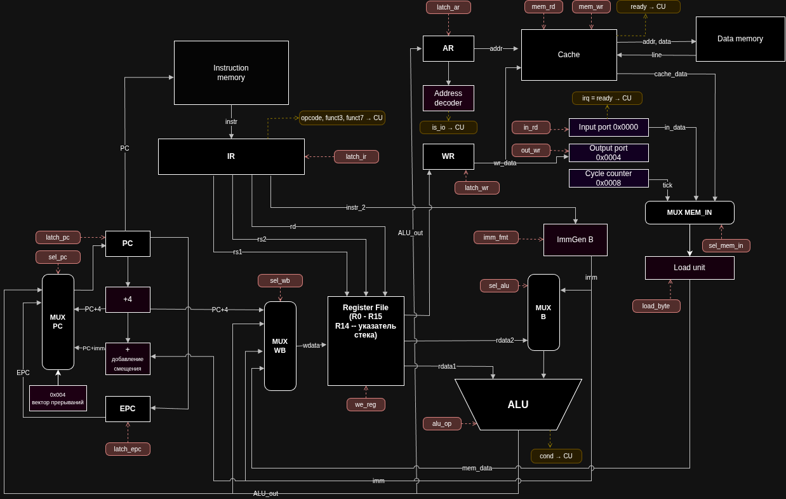
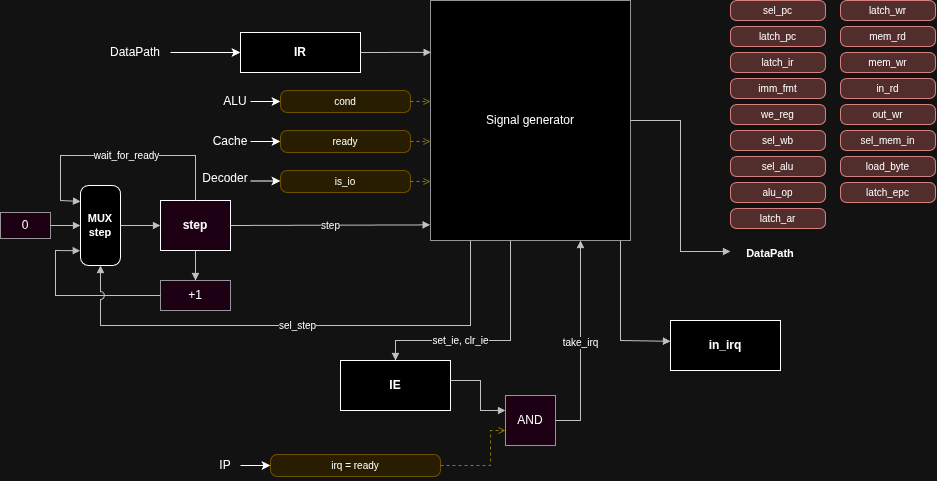

# Архитектура компьютера

---

# Лабораторная работа №4

---

**Студент:** Лишик Александра Юрьевна  
**ИСУ:** 503302

## Вариант

```text
asm | risc | harv | hw | trap | mem | cstr | cache | alg2
```

| Параметр | Реализация |
|---|---|
| `asm` | Ассемблер, раздельная трансляция и линковка |
| `risc` | RISC-архитектура |
| `harv` | Гарвардская организация памяти |
| `hw` | Аппаратный блок управления |
| `trap` | Обработка прерываний |
| `mem` | Memory-mapped I/O |
| `cstr` | C-строки, завершающиеся нулевым байтом |
| `cache` | Кэш данных |
| `alg2` | Алгоритм №2 |

---

#### [ссылка на документацию memory](docs/memory.md)
#### [ссылка на документацию isa](docs/isa.md)
#### [ссылка на документацию test](docs/test.md)
#### [ссылка на документацию translator](docs/translator.md)

---


## Модель процессора 

---

### Схема DataPath



### Схема ControlUnit



## Особенности реализации процесса моделирования

## 1. Общая характеристика

Процессор представляет собой модель 32-битной RISC-архитектуры с Гарвардской организацией памяти. Память инструкций и память данных разделены и имеют независимые адресные пространства. Инструкции имеют фиксированную длину 32 бита, доступ к данным осуществляется по байтовым адресам. Используется little-endian порядок байтов.

Модель включает регистровый файл (16 регистров идея взята из rv32e, подробнее на схеме и ниже в документации), PC, IR, ALU, блок формирования непосредственных значений (стоит наверное уточнить, что исходя из спецификации risk архитектуры, действия над непосредственными операндами запрещены, данный блок необходим для прыжков и загрузки данных),

средства вычисления адресов, память инструкций и данных, кэш данных(при переполнении удаляются данные, которые были использованы последними, так же стоит учесть что работа с I/O не попадает в кэш), а также устройства ввода-вывода, отображённые в пространство памяти.

### 1.1. Основные характеристики

| Характеристика | Значение |
|---|---|
| Архитектура | RISC |
| Разрядность | 32 бита |
| Регистры общего назначения | 16 регистров (некоторые зарезервированы) × 32 бита |
| Длина инструкции | 32 бита (4 байта) |
| Организация памяти | Гарвардская |
| Порядок байтов | Little-endian |
| Адресация | Побайтная |
| Память инструкций | 2^16 |
| Память данных | 2^32 |
| Ввод-вывод | Memory-Mapped I/O |
| Обработка входных событий | Прерывания |

## 2. Структура процессора

Основные компоненты модели:

- **PC (Program Counter)** — хранит адрес текущей инструкции и участвует в формировании адреса следующей.
- **IR (Instruction Register)** — содержит считанную инструкцию (дальше инструкция уходит в контрл юнит).
- **Register File** — 16 регистров общего назначения R0–R15 (часть из них зарезервирована, на схеме указано).
- **ALU** — выполняет арифметические, логические операции, сдвиги и сравнения.
- **ImmGen** — формирует непосредственное значение из полей инструкции (важно учесть, что действия над непосредственными операндами запрещено, подробнее о логике реализации дополню устно).
- **AR (Address Register)** — промежуточно хранит эффективный адрес обращения к памяти (который позже сохранится в кэш вместе сданными, если адрес не принадлежит I/O).
- **WR (Write Register)** — промежуточно хранит данные, полученные при чтении памяти (после уходит в кэш).
- **Cache** — кэш данных для обращений к обычной памяти.
- **Address Decoder** — определяет область адреса, включая MMIO(первые 12 байт).
- **Load Unit** — обрабатывает данные, полученные из памяти, с учётом размера операции(необходим так как чтение разрешено 8 и 32 бит).
- **IMEM** — память инструкций.
- **DMEM** — память данных.
- **EPC (Exception Program Counter)** — сохраняет адрес возврата при обработке входного прерывания.
- **MMIO-устройства** — ввод, вывод и счётчик тактов.

## 3. Регистровая система

### 3.1. Регистры общего назначения

Регистровый файл содержит 16 регистров шириной 32 бита: R0–R15. Он обеспечивает чтение двух операндов и запись результата.

| Регистр | Назначение |
|---|---|
| R0 | Константный ноль |
| R1–R15 | Регистры общего назначения |

Запись в R0 игнорируется; регистр всегда сохраняет значение 0. R14 -- стековый регистр.

### 3.2. Program Counter (PC)

PC хранит адрес инструкции в памяти инструкций. При последовательном исполнении адрес следующей инструкции вычисляется как:

\[PC_{next}=PC+4\]

Для перехода на следующую инструкцию используется либо загрузка адреса непосредственно, либо увеличение счетчика на 4 байта прошлой команды, либо увеличение счетчика + offset, либо обработка вектора прерывания.

### 3.3. Instruction Register (IR)

IR хранит 32-битное машинное представление инструкции, извлечённой из IMEM. На стадии декодирования содержимое IR преобразуется в структуру инструкции с opcode, полями регистров и непосредственным значением.

### 3.4. Exception Program Counter (EPC)

EPC используется при обработке входного прерывания. При принятии прерывания в EPC сохраняется текущий PC. Инструкция `IRET` возвращает управление по адресу EPC.

## 4. Арифметико-логическое устройство

ALU работает с 32-битными операндами. Источниками операндов являются значения регистров и непосредственные значения.

Подробнее можно прочитать в документации isa ([документация с описанием isa](docs/isa.md))

## 5. Организация памяти

Instruction Memory — отдельная память размером 64 KiB. Инструкции считываются по адресам, выровненным на 4 байта, и хранятся в little-endian представлении. Начальная точка выполнения задаётся reset vector.

[ссылка на документацию memory](docs/memory.md)

## 6. Кэш данных

Кэш используется для ускорения чтения и записи обычной памяти данных. MMIO-область обходится без кэширования. При обращении к памяти кэш определяет попадание или промах и возвращает задержку, учитываемую моделью выполнения. Кэш предоставляет статистику, включая hits, misses и hit rate. Конкретные параметры и алгоритм работы описываются отдельно в документации Cache.

## 7. Цикл выполнения инструкции

Модель реализует последовательное выполнение стадий. Каждая стадия обрабатывается отдельным тактом модели.

## 8. Обработка входных прерываний

Входное устройство имеет однобайтовый буфер. Поступление входного байта устанавливает признак ожидающего прерывания.

Прерывание принимается на стадии FETCH, если процессор не находится внутри обработчика:
1. Текущий PC сохраняется в EPC.
2. PC устанавливается в адрес обработчика, полученный из INPUT_VECTOR.
3. Сбрасывается pending_interrupt.
4. Устанавливается признак нахождения в обработчике.

## 9. Сброс и запуск

При сбросе:
- регистры общего назначения очищаются;
- SP устанавливается в начальное значение;
- PC загружается из RESET_VECTOR;
- IR и EPC обнуляются;
- счётчик тактов обнуляется;
- флаги остановки и обработки прерывания сбрасываются;
- трассировка очищается;
- кэш очищается, статистика сбрасывается.
